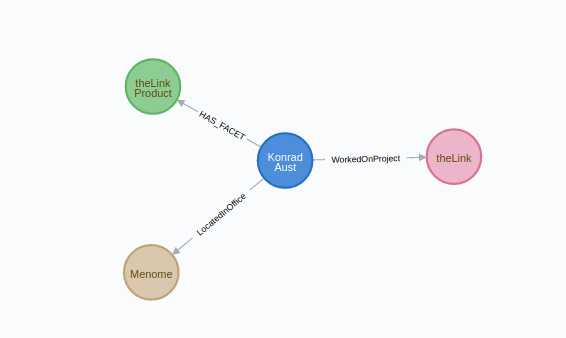
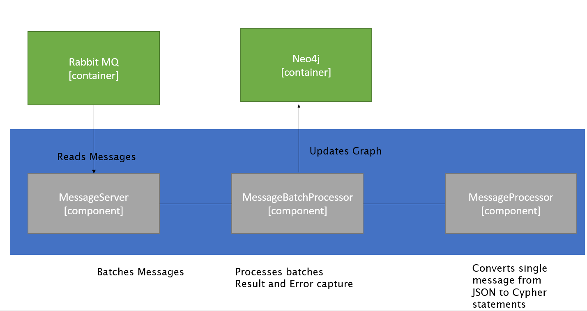

# Overview
This project reads messages in a specific structure from a RabbitMQ queue and converts them into Neo4J database graph updates 

# Example
```json5
  {
    "Name": "Konrad Aust",
    "NodeType": "Employee",
    "Priority": 1,
    "SourceSystem": "HRSystem",
    "ConformedDimensions": {
      "Email": "konrad.aust@menome.com",
      "EmployeeId": 12345
    },
    "Properties": {
      "Status": "active",
      "PreferredName": "The Chazzinator",
      "ResumeSkills": "programming,peeling bananas from the wrong end,handstands,sweet kickflips"
    },
    "Connections": [
      {
        "Name": "Menome Victoria",
        "NodeType": "Office",
        "RelType": "LocatedInOffice",
        "ForwardRel": true,
        "ConformedDimensions": {
          "City": "Victoria"
        }
      },
      {
        "Name": "theLink",
        "NodeType": "Project",
        "RelType": "WorkedOnProject",
        "ForwardRel": true,
        "ConformedDimensions": {
          "Code": "5"
        }
      },
      {
        "Name": "theLink Product Team",
        "NodeType": "Team",
        "Label": "Facet",
        "RelType": "HAS_FACET",
        "ForwardRel": true,
        "ConformedDimensions": {
          "Code": "1337"
        }
      }
    ]
  }
```

Resulting Cypher statements. Messages are grouped by *signature* (label, dimension keys, property keys) and each group is written with a single `UNWIND $parms AS param` statement. Identifiers are always backtick-quoted.

```
CREATE CONSTRAINT IF NOT EXISTS FOR (n:`Employee`) REQUIRE (n.`Email`, n.`EmployeeId`) IS UNIQUE

UNWIND $parms AS param
MERGE (n:`Employee` {`Email`: param.`Email`, `EmployeeId`: param.`EmployeeId`})
ON CREATE SET n.`Uuid` = randomUUID(), n.`TheLinkAddedDate` = datetime()
SET n.`Name` = param.`Name`, n.`PreferredName` = param.`PreferredName`, n.`Priority` = param.`Priority`, ...

UNWIND $parms AS param
MERGE (n:`Office` {`City`: param.`City`}) ON CREATE SET ... SET n.`Name` = param.`Name`   -- likewise Project, Team

UNWIND $parms AS param
MATCH (s:`Employee` {`Email`: param.`s:Email`, `EmployeeId`: param.`s:EmployeeId`})
MATCH (d:`Office` {`City`: param.`d:City`})
MERGE (s)-[r:`LocatedInOffice`]->(d)
```

Resulting Graph



## Objectives
The primary objective of this project is to update the graph as fast as possible. 
- Messages are streamed off of the Rabbit queue into batches. The batch size defaults to 500 but can be configured (see Environment/Configuration Variables below.) 
- The next batch is parsed while the previous one is written (a pipeline), and `WRITER_THREADS` can write several batches at once.
- Planned work is on the board in `docs/KANBAN.md`; the analysis behind it is in `docs/THROUGHPUT.md`.

## Performance
Measured on a pinned Neo4j 2026.10.1 Community container (4 CPUs, 8 GB, 2 GB heap and page cache) on one Docker host, 150,000
messages per profile, parse + group + write with **no RabbitMQ in the loop** (`docs/benchmarks/README.md` has the method, the
environment of every run and the raw reports). The numbers are messages per second.

| Profile | What it is | First measurement (2026-11-01, batch 500, 1 writer) | Now (2026-11-02, Java 25, batch 500, 1 writer) | Now, 4 writers | Now, batch 2000, 4 writers |
|---|---|---|---|---|---|
| node-only | nodes, no relationships | 34,469 | 43,639 | 140,919 | 163,455 |
| hubs3 | each message links 3 shared hub nodes | 10,979 | 21,317 | 31,151 | 38,769 |
| hub-fanout | each message links 1 shared hub node | 20,682 | 32,908 | 40,348 | 49,660 |
| wide | many properties and relationships per message | 5,244 | 7,761 | 8,803 | 8,484 |
| unique-dest | each message links 3 unique nodes | 8,203 | 12,834 | 35,971 | 35,272 |

What to take from it, and what not to:
- Statement batching, one transaction per phase, the parse/write pipeline and parallel writers account for the gain. The first
  column was taken before several of those changes (and before the uniqueness constraint, which costs up to about 10% on
  node creation); the Java 21 to 25 upgrade did not change the hub profiles.
- Messages that all point at the same few nodes (hubs) saturate near 38k (hubs3), 45k (hub-fanout) and 8k (wide) msg/s however
  many writers or sessions there are: a relationship write-locks both ends. More writers only help workloads that do not share nodes.
- `BATCH_SIZE` 2000 instead of 500 gave +16% to +46% on node-only, hubs3 and hub-fanout and nothing on wide and unique-dest, at
  the cost of up to about 5x the p99 batch time. This is a single run per cell and under 5% is noise. The default stays 500
  until KANBAN E3-14 has checked it further.
- These are single-instance Community numbers on one laptop-class Docker host. A 3-member cluster costs 16-45% of write
  throughput (`docs/CLUSTER.md`). They say nothing yet about Kafka or Spark connectors, server-class hardware, or the path through
  RabbitMQ at scale (KANBAN E10-2 to E10-4). **No claim is made that this is faster than any other tool.**
- The replay "ceiling" harness (`./gradlew ceiling`) turned out to be a lower bound (the real server beat it by 4-35%), so no
  "percent of ceiling" is quoted. See `docs/benchmarks/README.md`.

## Principals

#### Immutability 
Given that each batch will be processed by a thread, I wanted to ensure there was no state kept in the objects. To that end, I opted to adopt some principals from the functional programming world. The first one being immutability. In my processing framework, once an object is created it's not modified. This is done by convention as there aren't too many immutable data structures in Java/Groovy. There are other pure functional languages implemented on the JVM Clojure (Lisp based) and Frege(a Haskel) being two of the more popular functional languages. Scala is another option, but it's more of an Object/Functional hybrid. 

#### Pure Functions
Another aspect of a functional approach is ensuring functions don't have side effects. That is given a set of arguments, the function is guaranteed to return the same value and won't impact the 'outside' world. There are no language semantics to express this concept in Java/Groovy so again this is by convention. I opted to implement all behaviour as static functions. This helps enforce statelessness in the objects as static functions can't access instance variables in a class. In the classes I've implemented, there aren't any instance variables so this point is moot, however it's good practice to enforce this at the class level. The system does perform logging at various levels which does violate the no side effect principal, but that's an acceptable exception in my opinion.   

#### No Shared Mutable State
Given the two principals of immutability and pure functions the goal is not to have any shared state which could be mutated. This is particularly important when we have multiple threads in play. Sharing state that could be mutated in multiple threads is a recipe for disaster. 

#### Test Driven
There are a number of tests that validate the correctness of the implementation. They were developed in concert with the code. In many cases, tests were written before the implementation. Tests are implemented using the Spock BDD framework (http://spockframework.org/) 


## Technology

- JVM (Java 25) (https://openjdk.java.net/)
- Groovy (5.0.x, managed by Micronaut) (https://groovy-lang.org/)
- Micronaut (5.2.x) (https://micronaut.io/)
- Project Reactor (https://projectreactor.io/)
- RabbitMQ (https://www.rabbitmq.com/)
- Neo4J 5.x / 2026.x (https://neo4j.com/) with Java driver 6.3
- Docker (https://www.docker.com/)

Testing
- Spock (http://spockframework.org/)
- Test Containers (https://www.testcontainers.org/)
        

## Solution Overview
The message processing solution consists of three primary classes, a few utility classes and tests in the form of Spock specifications. This section describes each of the major components, how they relate and anything significant about them. 

At a high level, the system reads messages from a Rabbit MQ queue, collects the message stream into batches, converts each entry in the batch to a series of Neo4J Cypher statements and writes the batch to the graph database in at most three transactions (nodes, relationships, node deletes).




### Message Server
The MessageServer (com.menome.MessageServerCommand) is the main entry point for the system. It can be launched from the command line, through an iIDE (IntelliJ for example) or packaged into a docker container.

When the server starts, it will check to ensure it can connect to both Rabbit MQ and Neo4J. Status messages are  logged to standard out via the Logback logging framework at INFO level.  Here is a typical startup sequence:

```
10:43:40.149 [main] INFO  i.m.context.env.DefaultEnvironment - Established active environments: [cli]
10:43:40.587 [main] INFO  c.m.datarefinery.DataRefineryServer -  __  __
10:43:40.588 [main] INFO  c.m.datarefinery.DataRefineryServer - |  \/  | ___ _ __   ___  _ __ ___   ___
10:43:40.588 [main] INFO  c.m.datarefinery.DataRefineryServer - | |\/| |/ _ \ '_ \ / _ \| '_ ` _ \ / _ \
10:43:40.588 [main] INFO  c.m.datarefinery.DataRefineryServer - | |  | |  __/ | | | (_) | | | | | |  __/
10:43:40.588 [main] INFO  c.m.datarefinery.DataRefineryServer - |_|  |_|\___|_| |_|\___/|_| |_| |_|\___|
10:43:40.588 [main] INFO  c.m.datarefinery.DataRefineryServer - Starting Server
10:43:40.588 [main] INFO  c.m.datarefinery.DataRefineryServer - Starting Monitoring Services
10:43:40.887 [main] INFO  io.micronaut.runtime.Micronaut - Startup completed in 292ms. Server Running: http://localhost:8080
10:43:40.915 [main] INFO  com.menome.util.RabbitMQ - Connecting to RabbitMQ server 127.0.0.1 on port 5672 with user menome
10:43:40.965 [main] INFO  c.m.datarefinery.DataRefineryServer - Connected to Rabbit MQ Server OK
10:43:40.986 [main] INFO  com.menome.util.Neo4J - Connecting to Neo4J server bolt://localhost:7687 with user neo4j
10:43:41.194 [main] INFO  c.m.datarefinery.DataRefineryServer - Connected to Neo4J Database Server OK - version:4.0.4 edition:community
10:43:41.201 [main] INFO  c.m.datarefinery.DataRefineryServer - Message Server waiting for messages on queue test_queue processing messages with a batch size of 5000
10:43:41.267 [main] INFO  c.m.datarefinery.DataRefineryServer - Server Started
10:43:41.278 [rabbitmq-receiver-connection-subscription-2] INFO  reactor.rabbitmq.Receiver - Consumer amq.ctag-cp44adLvVKbIvBXYyKrSCg consuming from test_queue has been registered
```

A couple of things to note
- The monitoring server starts first. it's the one running at port 8080 above.
- The rabbit connection is established next. If successful it will display Connected to Rabbit MQ Server OK 
- The Neo4J connection is established next. If successful it will display Connected to Neo4J Database Server Ok with the version and edition of the Neo4J instance.
- Finally, the queue the server is listening on, and the batch size has been configured are displayed.

The server sets up a Reactive stream to listen for messages on the Rabbit queue. 

```groovy
receiver.consumeManualAck(queue, new ConsumeOptions().qos(prefetch))
        .bufferTimeout(batchSize, Duration.ofSeconds(2), true)
        .map({ deliveries -> new Batch(deliveries, deliveries.collect { new String(it.getBody(), UTF_8) }) })
        // BatchPipeline: parse on PARSER_THREADS, write on WRITER_THREADS, ack after commit, nack+requeue on infrastructure errors
        BatchPipeline.run(batches, driver, registry, parsers, writers, ...)
```

Messages flow in unacknowledged, their contents are pulled out into Strings.
The buffer fills until the batch size is met or two seconds have elapsed.
The batch is sent to the MessageMatchProcessor.
Each batch is acknowledged only after it commits. The results are logged. 

 
### Message Batch Processor 
The message batch processor takes a batch of messages (currently an Arraylist<String>). Messages are grouped into maps of the same type. This is to ensure we can apply the same parameter type across all messages. In many cases the batch will have exactly the same message types, but we can't be guaranteed of that.

The messages in each sub batch are processed. 
- Indexes for the nodes in the batch are created if they are not present in the database.
- Connection nodes are merged. This is an optimization that assumes that the cardinality between primary nodes and their connections is low. That is to say, if we have connections to things like code descriptions or cities, there will be fewer of them than the primary nodes we are inserting. Merging them once instead of for each statement is efficient.  
- Parameters for each of the primary nodes are collected into a list. An UNWIND is prepended to the primary node merge and the batch is sent off to Neo4J.

#### Error Handling
Messages are acknowledged only after their batch is committed. A batch is written in at most three managed write transactions (nodes, relationships, node deletes; the driver retries transient errors). Three kinds of failure are handled differently:
- **Invalid messages** (schema violations, malformed JSON) are reported individually and the rest of the batch proceeds.
- **Data errors** from Neo4j (for example a nested object used as a property value) cause the group to be split in half and retried recursively until the offending message is isolated (inspired by git bisect). Splitting never drops elements.
- **Infrastructure errors** (connection lost, authentication, exhausted transient retries) are not the data's fault: the whole batch is nacked and requeued after a short pause. Every statement is an idempotent MERGE, so reprocessing is safe.

Messages that fail are published, with the error text in an `x-error` header, to the durable queue `<RABBITMQ_QUEUE>.errors` (override with `RABBITMQ_ERROR_QUEUE`) and counted as errors.

### Neo4JNode / Neo4JConnection
These classes own the Cypher for their kind of element. `signature()` decides which elements share a statement, so a batch can mix messages with different property sets or relationship directions without losing anything.

### Utility Classes
Neo4J - contains methods for establishing connections to and running cypher statements against the Neo4J database.

RabbitMQ - contains methods for establishing connections to the Rabbit MQ message bus.

## Gradle
The project is built using Gradle (https://gradle.org). All of the external dependencies are declared and managed through the build.gradle file at the root of the project.


## How to Build/Run 

Ensure you have a JDK 25 installed (the Micronaut Gradle plugin refuses to run on 21; versions are listed in `docs/DEPENDENCIES.md`). I highly recommend SDKMan (https://sdkman.io/) to manage Java and related tooling versions. 

Execute the following from the command line

```shell script
./gradlew build
```
----

To run the tests execute:

```shell script
./gradlew test
```

You can review the results of the test run by opening the index.html file found at build/reports/tests/test/index.html

----
To start the server and have it listen for Rabbit messages on the queue

```shell script
./gradlew run
```

## Building a Docker Image
In the root directory of the project there is a Dockerfile. It can be used to build a docker image to run the server.

```shell script
./gradlew clean assemble shadowJar
docker build -t menome/message-server:v1 .
docker run -p 8080:8080 -e RABBITMQ_HOST=<RABBITMQ_HOST_IP_ADDRESS> -e NEO4J_HOST=<NEO4J_HOST_IP_ADDRESS> menome/message-server-1.0:latest
```
   

## Environment/Configuration Variables
These are the environment variables that are used by the message server to configure the connections to Rabbit MQ and Neo4J. See the ApplicationConfiguration class for the implementation.

|Environment Variable       | Default Value |
|---                        |---------------|
|RABBITMQ_HOST              | localhost     |
|RABBITMQ_PORT              | 5672          |
|RABBITMQ_USER              | menome        |
|RABBITMQ_PASSWORD          | menome        |
|RABBITMQ_QUEUE             | test_queue    |
|RABBITMQ_ERROR_QUEUE       | <queue>.errors|
|RABBITMQ_EXCHANGE_TYPE     | direct        |
|RABBITMQ_BATCH_SIZE        | 500           |
|RABBITMQ_EXCHANGE          | test_exchange |
|                           |               |
|NEO4J_HOST                 | localhost     |
|NEO4J_BOLT_PORT            | 7687          |
|NEO4J_USER                 | neo4j         |
|NEO4J_PASSWORD             | password      |
|                           |               |
|SHOW_CONNECTION_LOG_OUTPUT | Y             |
|HTTP_SERVER_PORT           | 8081          |    
|                           |               |
|ENABLE_METRICS             | N             |
|ENABLE_TEST_ENDPOINTS      | N             |
|CASE_STYLE                 | camel         | (camel, lower or upper: names of Name, Uuid, TheLinkAddedDate, ...)
|WRITER_THREADS             | 1             | (threads writing batches to Neo4j at the same time; 1 keeps batches in arrival order; see Upgrade notes)
|PARSER_THREADS             | 1             | (threads parsing the next batches while the writers write; 1 is enough for 2 writers, use 2 for 4 or more)
|RELATIONSHIP_TRANSACTIONS  | phase         | (phase: one transaction for all relationship statements of a batch; statement: one per statement, shorter locks on shared nodes, more commits)
|KEY_CONSTRAINT             | unique        | (unique: uniqueness constraint on a node type's dimension keys; nodekey: NODE KEY, Enterprise only, falls back to unique; index: plain index, no uniqueness guarantee)

## Docker Compose
There is a docker-compose.yml in the root of the project that can be used to spin up  message server, neo4j and rabbitmq containers. After doing a docker build as illustrated above

```shell script
docker compose up
```

This will pull down the required images and start them up, setting up default users, ports etc.

Below is the end of the compose logs. You should see something similar. These two messages indicate that the message server can connect to RabbitMQ and Neo4j

```shell script
message-server-message-server-1  | 21:57:12.846 [main] INFO  com.menome.MessageServerCommand - Connected to Neo4J Database Server OK - version:4.0.3 edition:community
```

```shell script
neo4j                            | 2022-11-11 21:57:04.876+0000 INFO  Starting...
neo4j                            | 2022-11-11 21:57:12.555+0000 INFO  Called db.clearQueryCaches(): Query cache already empty.
neo4j                            | 2022-11-11 21:57:12.613+0000 INFO  Bolt enabled on 0.0.0.0:7687.
neo4j                            | 2022-11-11 21:57:12.613+0000 INFO  Started.
message-server-message-server-1  | 21:57:12.846 [main] INFO  com.menome.MessageServerCommand - Connected to Neo4J Database Server OK - version:4.0.3 edition:community
message-server-message-server-1  | 21:57:12.925 [main] INFO  com.menome.MessageServerCommand - Message Server waiting for messages on queue test_queue processing messages with a batch size of 500
message-server-message-server-1  | 21:57:12.980 [main] INFO  com.menome.MessageServerCommand - Server Started
rabbitmq                         | 2022-11-11 21:57:12.983739+00:00 [info] <0.666.0> accepting AMQP connection <0.666.0> (172.19.0.2:48494 -> 172.19.0.3:5672)
rabbitmq                         | 2022-11-11 21:57:12.985168+00:00 [info] <0.666.0> connection <0.666.0> (172.19.0.2:48494 -> 172.19.0.3:5672) has a client-provided name: test_queue
rabbitmq                         | 2022-11-11 21:57:12.985862+00:00 [info] <0.666.0> connection <0.666.0> (172.19.0.2:48494 -> 172.19.0.3:5672 - test_queue): user 'menome' authenticated and granted access to vhost '/'
message-server-message-server-1  | 21:57:12.988 [rabbitmq-receiver-connection-subscription-1] INFO  reactor.rabbitmq.Receiver - Consumer amq.ctag-qg04yer_kXEnkxXVIKVVcA consuming from test_queue has been registered
neo4j                            | 2022-11-11 21:57:13.241+0000 INFO  Remote interface available at http://0.0.0.0:7474/
message-server-message-server-1  | 21:58:28.201 [default-nioEventLoopGroup-1-2] INFO  com.menome.util.RabbitMQ - Connecting to RabbitMQ server rabbitmq on port 5672 with user menome
rabbitmq                         | 2022-11-11 21:58:28.203885+00:00 [info] <0.679.0> accepting AMQP connection <0.679.0> (172.19.0.2:33176 -> 172.19.0.3:5672)
rabbitmq                         | 2022-11-11 21:58:28.206556+00:00 [info] <0.679.0> connection <0.679.0> (172.19.0.2:33176 -> 172.19.0.3:5672): user 'menome' authenticated and granted access to vhost '/'
```

See the docker-compose.yml file for the specific ports/user ids and passwords used to provision the containers. 
                 

## Installing docker and docker compose into a new Ubuntu 22.10 instance

The following is provided as an illustration of getting the message server up and running on a brand new installation with just docker and docker compose.


```shell script
  apt-get update
  apt-get upgrade
  apt install apt-transport-https ca-certificates curl software-properties-common
  curl -fsSL https://download.docker.com/linux/ubuntu/gpg | sudo gpg --dearmor -o /usr/share/keyrings/docker-archive-keyring.gpg
  echo "deb [arch=$(dpkg --print-architecture) signed-by=/usr/share/keyrings/docker-archive-keyring.gpg] https://download.docker.com/linux/ubuntu $(lsb_release -cs) stable" | sudo tee /etc/apt/sources.list.d/docker.list > /dev/null
  apt update
  apt-cache policy docker-ce
  apt install docker-ce
  systemctl status docker
  mkdir -p ~/.docker/cli-plugins/
  curl -SL https://github.com/docker/compose/releases/download/v2.3.3/docker-compose-linux-x86_64 -o ~/.docker/cli-plugins/docker-compose
  chmod +x ~/.docker/cli-plugins/docker-compose
  docker compose version
  take message-server
  touch docker-compose.yml 
  # open docker-compose.yml in an editor (nano, vim, emacs whatever) and replace contents with docker-compose.yml contents in this repository 
  
  docker login
  # your docker hub login must have access to the menome repository in order to pull the menome/message-server:latest image 
  
  docker compose up
  
  # Have the message server generate a bunch of test messages.
  curl -X POST http://localhost:8081/GenerateTestMessages/50000


```

## Generating Test Messages from a server end point
The test endpoints are disabled unless `ENABLE_TEST_ENDPOINTS=Y` (they return 404 otherwise).

It might be helpful to generate a bunch of test messages to evaluate the configuration and to check the server performance. 

The following URL will generate n messages

```
POST http://server:HTTP_SERVER_PORT/GenerateTestMessages/<number of messages, 1..1,000,000>
```
 
For example:

```
curl -X POST http://localhost:8081/GenerateTestMessages/50000
```

Will generate 50,000 test messages

## Deleting Test Messages
Removing the test messages from the Neo4J server can be done via the following endpoint

```
POST http://server:HTTP_SERVER_PORT/DeleteTestMessages
```
 
For example:

```
curl -X POST http://localhost:8081/DeleteTestMessages
```

Will delete all nodes from Neo4J that have a node with a property of SourceSystem with a value of menome_test_framework 

The code behind this endpoint is the equivalent of executing this cypher statement:
 
```match (n) where n.SourceSystem='menome_test_framework' detach delete n```


## Upgrade notes
- All statements are sent as `CYPHER 25`, so they behave the same whatever `db.query.default_language` the database has (set it to `CYPHER_25` anyway; the compose file does).
- Requires Neo4j 5 or later (uses `CREATE INDEX IF NOT EXISTS`, `randomUUID()`, no APOC). Tested against 2026.10.1.
- Relationship properties come from `RelProps` / `DateRelProps` on a connection and are additive (`SET r.k = ...`). `Properties` on a connection are properties of the connected node. Previously `Properties` were written to both and replaced all relationship properties.
- Supported message features: `DateProperties` (ISO-8601 -> `datetime`), `Label` (stored as a property), `DeleteProperties`, `DeleteNode`, and on connections `DeleteRelationship`, `DeleteRelProps`, `DeleteNode`.
- Whole numbers are stored as integers (previously doubles).
- Test endpoints are POST and disabled by default. Redis is no longer used.
- `CASE_STYLE=lower` now means entirely lowercase (`thelinkaddeddate`).
- A message that sets `Uuid`, `TheLinkAddedDate` (or its own Name/Label/Priority/SourceSystem again) in `Properties`, `DateProperties`, `DeleteProperties` or `ConformedDimensions` is rejected as a bad message (error queue) instead of overwriting the managed property.
- Only statement/schema errors are treated as bad data. Cluster errors (for example `NotALeader` during a failover) and anything unclassified requeue the batch instead of moving messages to `<queue>.errors`. Use a `neo4j://` host (`NEO4J_HOST=neo4j://...`) against a cluster so writes are routed to the leader.
- Each node type now gets a **uniqueness constraint** on its dimension keys instead of a plain index (`KEY_CONSTRAINT`). Concurrent writers can no longer create duplicate nodes. On first use of a node type an index from an earlier version is dropped and replaced by the constraint (it brings its own index). If the graph already contains duplicate nodes the constraint cannot be created: the message server logs an ERROR with a query that finds the duplicates, keeps using a plain index, and runs without the guarantee until the duplicates are fixed and it is restarted. The constraint costs a little on every node create (up to about 10% throughput on workloads that mostly create new nodes, see `docs/benchmarks/`). A constraint violation is a bad-data error: the message goes to the error queue. Needs permission to create constraints.
- The next batch is now parsed while the previous one is being written (a pipeline), which raised throughput by 14-37% in the benchmark with no change in behaviour. `WRITER_THREADS` above 1 writes several batches at once and scaled up to 3.9x on messages that do not share nodes, but **two batches that carry the same node can then commit in either order**, so the node keeps the properties of whichever committed last (with 1 writer the last message wins, as before). Messages that all point at the same few nodes (hubs) gain little from more writers because a relationship write-locks both ends. Statements and rows are sent in one global order (label, then key) so writers do not deadlock each other. RabbitMQ prefetch is now `batch size x (parsers + writers + 1)`.
- **Clusters:** use a routing host (`NEO4J_HOST=neo4j://<host>`) so writes go to the leader. Verified against a 3-primary Enterprise cluster (`docs/CLUSTER.md`): a failover (graceful or hard) loses nothing, a write sent to a follower or while there is no quorum is requeued rather than dead-lettered, and 200,000 messages survived a 55 s quorum loss with every node exactly once. A cluster costs 16-45% of write throughput against a single instance with the same resources. `KEY_CONSTRAINT=nodekey` (Enterprise) now also upgrades an existing uniqueness constraint to a node key; Neo4j cannot hold both on the same keys.
- A batch commits in at most 3 write transactions (nodes, relationships, node deletes) instead of one per statement.

## Documentation
- `docs/benchmarks/README.md` - benchmark method and every report; `docs/CLUSTER.md` - cluster behaviour; `docs/DEPENDENCIES.md` - versions and what was deliberately not upgraded; `docs/THROUGHPUT.md` - throughput analysis and model; `docs/KANBAN.md` - planned work; `CLAUDE.md` - guide for Claude Code; `RESUME.md` - current state.

## Exchange type
Set `RABBITMQ_EXCHANGE_TYPE` (default `direct`).

       rabbitChannel.exchangeDeclare(exchange, "direct", true) // TODO: make exchange type configurable